# Exiles

**Stop paying Opus prices for grep.** Two Claude Code plugins: one sends every job to the right model, and the other shows your whole crew at work.

<p align="center"></p>

## Install

Run these in Claude Code, one at a time:

```
/plugin marketplace add ITMERowe/exiles
```

```
/plugin install auto-route@exiles
```

```
/plugin install hideout@exiles
```

```
/reload-plugins
```

Each plugin works on its own, so you can install just one. To install from a terminal, run the same commands as `claude plugin marketplace add …` and `claude plugin install …`.

## auto-route: the right model for every job

- **Seven ready-made agents.** Search and reading run on **Haiku**, edits on **Sonnet**, and risky reviews and hard debugging on **Opus**. **Fable** runs only when you ask for it.
- **Routing without asking.** Every session gets the routing rules. Every prompt gets a hidden note naming the agent and the skills that fit it. Code work, whether writing, reviewing or auditing, gets ponytail: the smallest complete change.
- **Cheap answers to simple questions.** Plain questions go to Haiku and technical ones to Sonnet, but only while the switch actually saves money.
- **Your setup, restored.** At session start it copies your `CLAUDE.md` and `Explore` agent into `~/.claude` if they are missing, and adds a short set of ADHD-friendly answer rules: action first, terse wording.
- **Opus on call.** Run `/advisor opus`, and Claude asks Opus at the hard moments instead of running on it the whole time.

| Ask | Goes to |
|---|---|
| "where is the login handler?" | `searcher` · Haiku |
| "summarize this post" | `reader` · Haiku |
| "rename these 40 files" | `editor` · Sonnet |
| "review the payment migration" | `reviewer` · Opus |
| "find the root cause of the flaky build" | `heavy` · Opus |

[How to change the routing →](plugins/auto-route/README.md)

## Hideout: your crew, live

- **The band** above the prompt shows plan progress and the usage left in your 5-hour and 7-day windows.
- **The tavern** tops the crew panel (`/agents-info`): a 2.5D pixel tavern where your crew hangs out by the fire. A crab walks out the door while its kind of agent is on a job and comes back when the job is done.
- **The crew panel** lists every agent with its model, progress and context. Click a row to see its tool calls.
- **Pixel crabs** act out each job. The Pathfinder searches, the Martial Artist edits, the Stormweaver reviews, and the Tactician plans the main session. The shell colour shows the model: Haiku grey, Sonnet blue, Opus yellow, Fable orange.

[More about Hideout →](plugins/hideout/README.md)

<details>
<summary><b>The full workflow</b>: the installer, with the companion plugins</summary>

```bash
git clone https://github.com/ITMERowe/exiles && cd exiles && sh install.sh
```

On Windows, run `./install.ps1` instead of `sh install.sh`. Paste the snippet it prints into `~/.claude/CLAUDE.md`, then run `/reload-plugins`.

Along with auto-route and Hideout, it installs ponytail (smallest-change code), caveman (terse replies), superpowers (process skills) and savvy-flow (a planner). To skip one, remove its line from [`plugins.txt`](plugins.txt) first.

Don't run Hideout alongside the original `savvy-progress`, or you'll get two panels.

</details>

<details>
<summary><b>Developing</b></summary>

From `plugins/auto-route` or `plugins/hideout`, after each change:

```bash
claude plugin validate .
```

```bash
claude plugin test .
```

</details>

## Credits

- **Hideout** began as a fork of [johnnyvizz](https://github.com/JohnnyVizz)'s [savvy-progress](https://github.com/JohnnyVizz/claude-kit/tree/main/plugins/savvy-progress) (MIT).
- **auto-route**'s `heavy` and `fable` tiers follow the workers in [savvy-flow](https://github.com/JohnnyVizz/claude-kit).
- The crab costumes are original pixel art based on *Path of Exile* and *Path of Exile 2* ascendancies. They are fan art, not affiliated with Grinding Gear Games.

MIT licensed, see [`LICENSE`](LICENSE).
