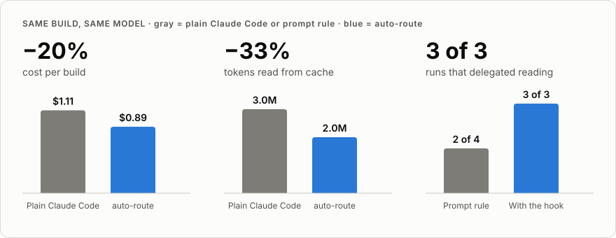

# Cutting the cost of agentic coding by delegating reads: a benchmark of auto-route

| | |
|---|---|
| **Tested baseline** | auto-route 0.5.9 · Hideout 3.0.6 |
| **Main model** | Claude Sonnet 5.5 (Claude Code desktop) |
| **Date** | 2026-11-14 |
| **Design** | Exploratory, sequential, one task, one run per build (n = 8). Not a controlled trial. |

## 1. Abstract

An agent session is billed mostly for re-reading its own context on every model call. We tested whether sending bulk reading to a cheaper model (Haiku), and *enforcing* that with a hook instead of asking for it in the prompt, lowers the cost of a real build without lowering the quality of the result.

On one task (build a developer portfolio from a public GitHub profile with seven repositories) the best build, run 7, cost **$0.89 against $1.11** for plain Claude Code (−$0.22, −19.8%), read **a third fewer tokens** (2.0M against 3.0M) and scored **32 against 25 of 35** on a seven-criterion rubric. Cost tracked cache-read tokens (r = 0.94, n = 8) and main-session calls (r = 0.97, n = 6). Delegation alone did not make a build cheap; fewer calls did. A prompt rule delegated the reading in 2 of 4 tests, the enforcing hook in 3 of 3.

The configurations changed between runs, so the result is about a *whole workflow*, not one variable. It supports a controlled replication, not a general claim of proven savings.

## 2. Questions and hypotheses

| | Hypothesis | Evaluated by |
|---|---|---|
| **H1** | Cost is driven by context re-read and call count, not by output. | Cost against cache-read tokens and against main-session calls. |
| **H2** | Delegating bulk reading to Haiku lowers cost without lowering quality. | Cost, calls and rubric score of delegating against non-delegating runs. |
| **H3** | A prompt-level delegation rule is unreliable; a `tool.call` hook is reliable. | Share of survey tasks in which reading was delegated, by mechanism. |

## 3. Method

### 3.1 Task and design
One brief, identical every time: analyse a public GitHub profile and its seven repositories, select and describe projects without inventing facts, build a static portfolio (home, filterable project list, project pages, expertise, about, contact), run the available checks, document it and report what was verified. Reading seven repositories is the expensive step that delegation targets, and the output can be audited against the repositories.

Each run used a fresh Claude Code session on Sonnet 5.5. Plain Claude Code is the control. Numbered runs are successive auto-route builds; defects found in one run were fixed before the next (section 6), so each comparison is between **whole configurations**.

### 3.2 Measures

| Variable | Source | Note |
|---|---|---|
| Cost, cache read and write, Haiku share, lines added | Session `/usage` panel | Haiku share is a share of usage, not a cost split. |
| Main-session calls, final context, subagent calls | Session transcript | Not available for the control or run 1. |
| Quality | Rubric below plus spot checks | One unblinded rater; run 6 not scored. |
| Delegation occurred | Transcript | Includes headless tests for H3. |

Derived: `points per dollar = rubric total ÷ cost`; `cost change = (configuration − control) ÷ control`. Correlations are Pearson r on the rounded table values, so they are approximate.

### 3.3 Quality rubric
Seven criteria, 1–5 each, equal weight, maximum 35. Anchors at 1, 3 and 5; 2 and 4 are in between.

| Code | Criterion | 1 | 3 | 5 |
|---|---|---|---|---|
| **F** | Verifiable facts | Claims wrong or unverifiable | Correct, cited to files only | Spot-checked claims correct; every engineering decision cites `file:line` |
| **C** | Coverage of the brief | Required pages or sections missing | All pages; projects thin | All pages and filter; each project has objectives, implementation, decisions, limits |
| **S** | SEO and static delivery | One JavaScript-rendered page | Static pages; partial meta or guessed deploy details | Per-page static HTML with title, description, canonical, Open Graph; deploy URL and base path configurable |
| **K** | Automated checks | None | One type check | Lint, types, tests and build, or a type check plus a check on the built output that can fail |
| **D** | Design (subjective) | Generic template, flat hierarchy | Clear hierarchy, little character | Distinct type and layout, restrained palette, evidence presented well |
| **P** | Performance | Heavy runtime on every page | 30–200 KB of JavaScript | ≤ 30 KB of JavaScript and ≤ 400 KB total output |
| **R** | Docs and honesty | None | README with run steps | README with structure and decisions; handoff lists what was not verified; sensitive data handled |

### 3.4 Verification
Each scored build was run (`build`, `check`, tests where present). A handful of claims per run were checked against clones of the repositories: line counts, commit counts, test-file counts and cited `file:line` references. Design was judged from the rendered home and project pages at desktop and phone width.

## 4. Results

### 4.1 Efficiency

| Run | Setup | Cost | Main calls | Cache read | Cache write | Final context | Haiku share | Lines added |
|---|---|---:|---:|---:|---:|---:|---:|---:|
| Plain | none | $1.11 | n/a | 3.0M | 96k | 142k | 0% | +1048 |
| 1 | early auto-route | $1.42 | n/a | 4.0M | 157k | 157k | 0% | +869 |
| 2 | 0.5.2 | $1.26 | 32 | 3.8M | 102k | 148k | 8% | +930 |
| 3 | 0.5.3 | $0.97 | 23 | 2.7M | 95k | 141k | 0% | +657 |
| 4 | 0.5.5 | $1.31 | 31 | 3.9M | 112k | 157k | 6% | +1188 |
| 5 | 0.5.6 | $1.08 | 26 | 2.9M | 92k | 139k | 6% | +431 |
| 6 | 0.5.7 | $1.33 | 36 | 4.6M | 108k | 154k | 0% | +879 |
| **7** | **0.5.9** | **$0.89** | **19** | **2.0M** | **87k** | **132k** | 2% | +659 |

- Run 7 has the lowest cost, calls, cache read and final context of the eight.
- An extra run of 0.5.4 cost $2.47 and is **not** in the table: all five explore agents ran on Sonnet (D1, section 6).
- Run 5 built six projects, not seven: the agent asked about a repository that publishes real bank details and the owner said to skip it. Its workload and score are not strictly comparable.

### 4.2 Quality

<table>
<thead>
<tr><th align="left">Run</th><th>F</th><th>C</th><th>S</th><th>K</th><th>D</th><th>P</th><th>R</th><th>Total</th></tr>
</thead>
<tbody>
<tr><td align="left">Plain</td><td align="center">3</td><td align="center">4</td><td align="center">2</td><td align="center">5</td><td align="center">3</td><td align="center">5</td><td align="center">3</td><td align="center"><b>25</b></td></tr>
<tr><td align="left">1</td><td align="center">4</td><td align="center">4</td><td align="center">4</td><td align="center">3</td><td align="center">4</td><td align="center">5</td><td align="center">4</td><td align="center"><b>28</b></td></tr>
<tr><td align="left">2</td><td align="center">5</td><td align="center">5</td><td align="center">4</td><td align="center">3</td><td align="center">4</td><td align="center">4</td><td align="center">5</td><td align="center"><b>30</b></td></tr>
<tr><td align="left">3</td><td align="center">4</td><td align="center">4</td><td align="center">4</td><td align="center">4</td><td align="center">4</td><td align="center">5</td><td align="center">4</td><td align="center"><b>29</b></td></tr>
<tr><td align="left">4</td><td align="center">5</td><td align="center">5</td><td align="center">2</td><td align="center">5</td><td align="center">5</td><td align="center">3</td><td align="center">5</td><td align="center"><b>30</b></td></tr>
<tr><td align="left">5</td><td align="center">5</td><td align="center">5</td><td align="center">4</td><td align="center">3</td><td align="center">4</td><td align="center">5</td><td align="center">5</td><td align="center"><b>31</b></td></tr>
<tr><td align="left">6</td><td colspan="8" align="center"><em>not scored (files not kept)</em></td></tr>
<tr><td align="left"><b>7</b></td><td align="center"><b>4</b></td><td align="center"><b>5</b></td><td align="center"><b>5</b></td><td align="center"><b>4</b></td><td align="center"><b>4</b></td><td align="center"><b>5</b></td><td align="center"><b>5</b></td><td align="center"><b>32</b></td></tr>
</tbody>
</table>

F facts · C coverage · S SEO and static delivery · K checks · D design · P performance · R docs and honesty. An empty score would mean "not scored", never zero.

**Spot checks**

| Run | Checked | Result |
|---|---|---|
| 7 | 9,145 source lines · 106 commits · 655 lines of `i18n.ts` · `ARCHITECTURE.md:66, 84, 85` | Correct |
| 7 | "13 end-to-end tests" | Imprecise: 11 suites plus 2 helper files |
| 3 | "10 end-to-end suites" | Wrong: 11 |
| 4, 5 | Cited `file:line` references and counts in a sample | Correct |
| 2 | Cited references | Not checked |

### 4.3 Cost-effectiveness

Sorted best first. Ranks are among the seven scored runs: cost 1 = cheapest, score 1 = highest.

| Run | Cost | Score (of 35) | **Points per $** | Cost rank | Score rank | Ratio rank |
|---|---:|---:|---:|:---:|:---:|:---:|
| **7** | $0.89 | 32 | **36.0** | 1 | 1 | 1 |
| 3 | $0.97 | 29 | 29.9 | 2 | 5 | 2 |
| 5 | $1.08 | 31 | 28.7 | 3 | 2 | 3 |
| 2 | $1.26 | 30 | 23.8 | 5 | 3= | 4 |
| 4 | $1.31 | 30 | 22.9 | 6 | 3= | 5 |
| Plain | $1.11 | 25 | 22.5 | 4 | 7 | 6 |
| 1 | $1.42 | 28 | 19.7 | 7 | 6 | 7 |

Run 7 is cheaper **and** higher-scoring than every other scored run, so it is first however cost and quality are weighted. That describes this dataset; it is not a predicted outcome of a repeat.

## 5. Hypotheses

### H1: cost follows context × calls

| Relationship | n | r | R² | Slope |
|---|---:|---:|---:|---|
| Cost against cache-read tokens | 8 | **0.94** | 0.89 | $0.21 per million tokens (intercept $0.47) |
| Cost against main-session calls | 6 | **0.97** | 0.95 | about $0.03 per call |

Token mix in run 7:

| Cached context read | Cached context written | Output | Cached share of all tokens |
|---:|---:|---:|---|
| 2.04M | 87k | about 32k | **98.5%** read and written together; **94.5%** reads alone |

Output is the transcript's sum; the usage panel's own output figure is lower. **Verdict: consistent with H1.** Cost and the two activity measures move together; the design does not separate them or prove which causes which, and the fits are descriptive, not billing formulas.

### H2: delegation and cost

| Group | Runs | n | Mean cost | Quality range |
|---|---|---:|---:|---|
| Delegated reading | 2, 4, 5, 7 | 4 | **$1.14** (exact $1.135) | 30–32 |
| Did not delegate | 1, 3, 6 | 3 | **$1.24** | 28–29 (run 6 not scored) |
| Plain Claude Code | n/a | 1 | $1.11 | 25 |

The $0.10 gap is inside the build-to-build spread, and the delegating mean is still above the plain control. Delegation appears in both a costly run (run 4, $1.31) and the cheapest (run 7, $0.89). It moves reading out of the main context but adds cold starts, wake-ups and returned reports; it paid off with few calls: run 7 made 19 calls, with three Haiku agents making 14 calls in total, against 32 calls in run 2 and 31 in run 4. Delegating runs scored 30–32, so quality did not visibly fall. **Verdict: partly supported.** The best result used delegation; the data do not show that delegation alone saves money.

### H3: prompt rule against hook

| Mechanism | Tests | Delegated |
|---|---|---:|
| Prompt note naming the survey step | Runs 4, 5, 6 and one headless test | **2 of 4** |
| `tool.call` gate refusing the main session's own clone until an explore agent exists | Run 7 and two headless tests | **3 of 3** |

The prompt rule failed where a routing rule saying jobs under about 20k tokens "stay here" gave the model an out. These are mechanism observations, not seven replicates of the full build. **Verdict: supported within these tests;** a general success rate is not established.

## 6. Defects found along the way

| | Symptom | Cause | Fix |
|---|---|---|---|
| **D1** | Explore agents ran on Sonnet ($2.47) | The agent file's YAML description held `broad: "medium"`; on a Windows (CRLF) checkout the frontmatter failed to parse and the runtime dropped the model, effort and tool settings | Description reworded (0.5.9); an `agent.spawn` hook also sets the model from the routing table (0.5.5) |
| **D2** | 25–30k tokens of agent reports re-read on every later call | Briefs overrode the agent's 15-row cap | 40 terse lines per repository (0.5.6) |
| **D3** | Verifier agent added calls and saved nothing | A short check delegated, then polled with `sleep` | Verifier only for output over about 3k tokens; no polling (0.5.6) |
| **D4** | Reading done inline despite the note | Soft rule plus a conflicting size rule | Enforcing gate (0.5.8) |
| **D5** | Gate bypassed | `gh api repos/…/contents` and `WebFetch` not covered | Both covered (0.5.8) |
| **D6** | Calls spent on dependency upgrades and one-step browser actions | No rule against either | Skip unrequested upgrades; batch tool steps (0.5.7) |
| **D7** | A static site built as a React single-page app | Nothing steered the stack | "Lightest stack the task needs" rule (0.5.7) |

D1, D4 and D5 were silent: the final site looked fine either way. D2 and D3 show that delegating without controlling returned context can cancel the saving. Because the fixes accumulated, run 7's result cannot be credited to any one of them.

## 7. Threats to validity

| Category | Limitation | Consequence |
|---|---|---|
| Statistical | One run per build. Runs 2–7 span $0.89–$1.33, a 16% coefficient of variation | The −20% against the control is about 1.2 such deviations: suggestive, not significant |
| Rater | One unblinded rater (the assistant that analysed the runs, reviewed by the author); design is subjective | Scores may reflect rater knowledge |
| Construct | The rubric rewards what the brief asked for | Another brief would weight differently; points per dollar mixes a judged score with a measured cost |
| Internal | Fixes between runs, an owner answer in run 5, run 6 not preserved | Differences cannot be attributed to delegation alone |
| Cost attribution | No re-fitted per-run prices | No dollar split by token type is claimed |
| External | One web task, one machine, one main model | An installed plugin and skill set gave an 80k-token starting context, about two thirds of every bill; CLI, mobile and backend projects, Opus or Fable as main model, macOS and Linux are untested |

## 8. Conclusion

The cheapest and highest-scoring build combined enforced delegation of bulk reading with few main-session calls: **$0.89 and 32/35 against $1.11 and 25/35** for plain Claude Code. Cost was strongly associated with cached context read and with call count; delegation was not sufficient on its own; the enforcing hook delegated more reliably than the prompt rule within the tests run. The effect is plausible, the sample is one run per build, and the claim stops there: repeated, controlled runs with an independent rater come next.

## 9. Reproducing

1. Install auto-route 0.5.9 and Hideout 3.0.6 (see the [README](../README.md)); use an empty working folder.
2. Run the brief from section 3.1 in a fresh Sonnet 5.5 session, once with the plugins disabled and once enabled.
3. Record `/usage` (cost, cache read and write, model split) and read the transcript for call counts and routing.
4. Build the result, run its checks, spot-check claims against the repositories and score it with section 3.3, ideally with a second rater.
5. Repeat each condition several times and report the spread.

## Data notes

- Eight primary observations; the $2.47 run and the headless tests are reported separately and never mixed into them.
- Missing quality stays missing: run 6 is in no ranking or group quality range.
- Values keep the precision of the usage panel; reconstructed statistics are approximate.
- Observed association is not causation, and the sample is too small for a significance test.
